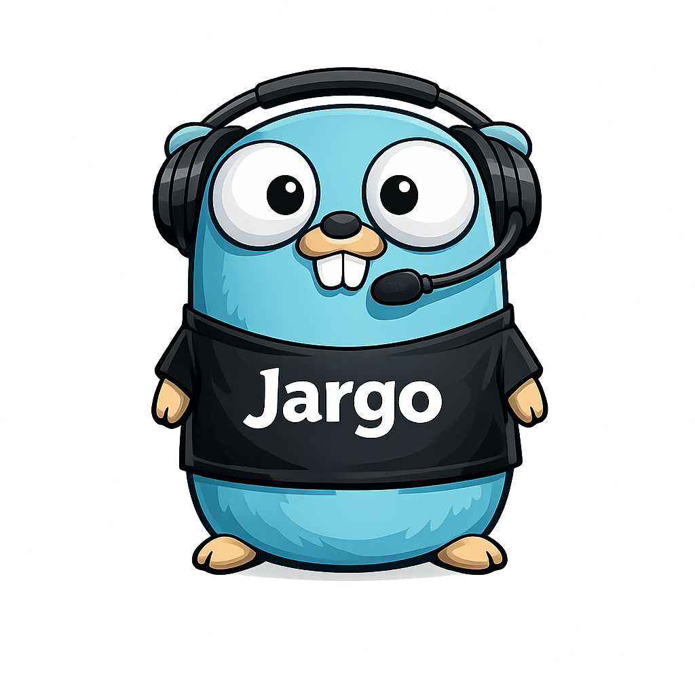
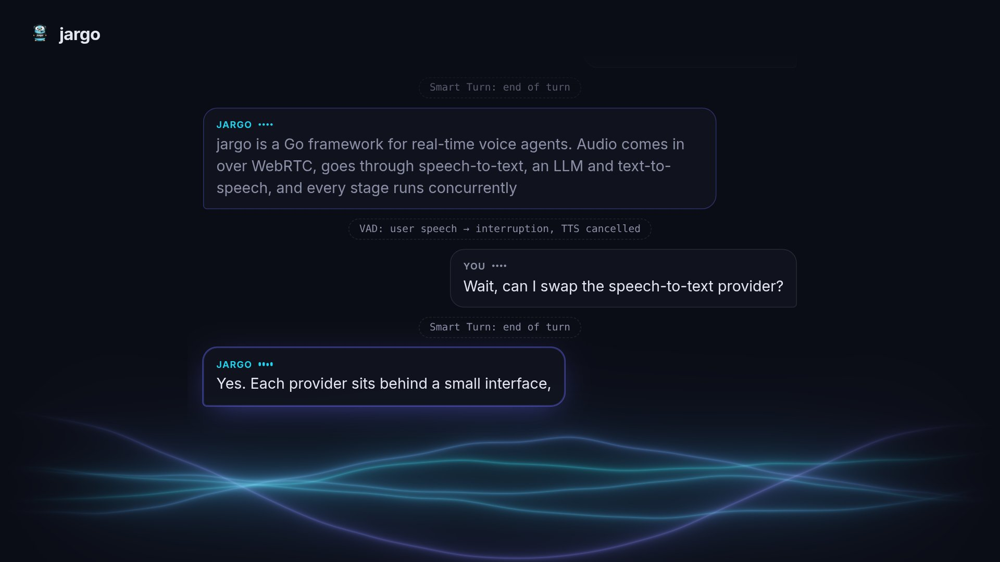

<div align="center">



**Real-time voice AI agents in Go.**

[](https://github.com/gojargo/jargo/actions/workflows/ci.yml)
[](https://codecov.io/gh/gojargo/jargo)
[](https://pkg.go.dev/github.com/gojargo/jargo)
[](https://securityscorecards.dev/viewer/?uri=github.com/gojargo/jargo)

[](https://github.com/gojargo/jargo/releases)
[](LICENSE)

</div>

---

**jargo** is a framework for real-time voice agents in Go: audio in over WebRTC,
a streaming transcription → reasoning → speech pipeline with turn-taking and
barge-in, and audio back out.

<p align="center">
  <a href="https://gojargo.dev/#demo"></a>
  <br />
  <sub><a href="https://gojargo.dev/#demo">Watch the demo</a>: turn-taking and barge-in, live.</sub>
</p>

## Try it in one minute

No API keys and no native libraries: the echo bot sends your microphone back to
you over WebRTC.

```sh
git clone https://github.com/gojargo/jargo && cd jargo
go run ./examples/echo        # then open http://localhost:8080
```

For a real voice agent, follow the
**[Quickstart](docs/getting-started/quickstart.md)**.

## Why?

[Pipecat](https://github.com/pipecat-ai/pipecat) is great, and jargo is a port of
it. The architecture and many design decisions are Pipecat's.

### Python might not be the way

This port exists for one reason: I'd rather not run a voice agent on Python.

Python is the right tool when you need the AI/data-science ecosystem. A
real-time voice *server* doesn't: the models run as services or as ONNX, and
what's left is plumbing: audio framing, WebRTC, concurrency, and shipping a
binary. For that, Go is a better fit: one static binary to deploy, low and
predictable memory, fast startup, and real concurrency for many simultaneous
sessions without a GIL. The heavy numerics stay where they belong (the ONNX
Runtime, the remote services), so giving up Python costs little here. See the
[benchmarks](#benchmarks) for the honest performance picture.

## Benchmarks

1,000 concurrent sessions served on 3 CPUs: one jargo process, against one
Pipecat 1.15 process per CPU (the GIL holds each to one core).

| | jargo | Pipecat |
|---|---|---|
| Memory, idle | 8.6 MiB | 162 MiB |
| Memory, 1,000 sessions | 124 MiB | 357 MiB |
| Throughput | 96k frames/s | 10.8k frames/s |
| Startup per session | 0.12 ms | 1.08 ms |

Medians of 6 runs on a GitHub-hosted runner (AMD EPYC 7763), every difference
significant. This is framework overhead only: provider round trips dominate what
a caller hears, and cost the same on both. [Method](docs/benchmarks.md).

## Features

- **Transports**: WebRTC ([Pion](https://github.com/pion)), WebSocket (server and client), LiveKit, WhatsApp Business calls, and local audio.
- **Telephony**: inbound and outbound calls over Twilio, Telnyx, Plivo and Exotel media streams, with DTMF input.
- **Audio**, pure Go: Opus encode and decode via [pion/opus](https://github.com/pion/opus), resampling via [go-resample](https://github.com/gojargo/go-resample). No cgo, and no build tag that adds any.
- **Streaming voice pipeline**: STT → LLM → TTS, with prompt caching and function calling.
- **Speech-to-speech**: single-model voice agents (OpenAI Realtime, Gemini Live, AWS Nova Sonic, xAI Realtime, Rime Prism).
- **50+ providers** behind small interfaces: swap any STT, LLM or TTS without touching the rest of the pipeline.
- **Turn-taking & barge-in**: [Silero VAD](https://huggingface.co/onnx-community/silero-vad) + [Smart Turn v3](https://huggingface.co/pipecat-ai/smart-turn-v3), local ONNX. Both models are embedded in the binary.
- **User-idle watchdog**: re-engage or hang up when the caller goes silent.
- **RTVI** data channel: works with existing RTVI clients, and with the
  [jargo web clients](https://github.com/gojargo/jargo-web) (JavaScript, React,
  Vue and web components).
- **Concurrent by design**: independent processors; interruptions are frames.

## Providers

Pick any per category; each is a small `Config` + constructor.

- **STT**: AssemblyAI, AWS Transcribe, Azure, Cartesia, Deepgram (incl. Flux),
  ElevenLabs, Fal, Gladia, Google Cloud, Gradium, Kyutai, Mistral, Moonshine
  (local), NVIDIA, OpenAI, Rime, Sarvam, Smallest, Soniox, Speechmatics,
  Together, Whisper (OpenAI, Groq, whisper.cpp), xAI.
- **LLM**: Anthropic (direct + Bedrock), AWS Bedrock, Azure OpenAI, Baseten,
  Cerebras, Crusoe, DeepSeek, Fireworks, Google Gemini (direct + Vertex), Groq,
  Mistral, Nebius, Novita, NVIDIA, Ollama, OpenAI (chat + Responses), OpenRouter,
  Perplexity, Qwen, SambaNova, Sarvam, Smallest, Together, xAI.
- **TTS**: AssemblyAI, Async, AWS Polly, Azure, Bland, Camb.ai, Cartesia,
  Deepgram, ElevenLabs, Fish, Google Cloud, Gradium, Groq, HeyGen, Inworld,
  Kokoro (local), Kyutai (incl. Pocket TTS), MiniMax, Mistral, Neuphonic, NVIDIA,
  OpenAI, Piper (local), Resemble AI, Rime, Sarvam, Smallest, Soniox, Speechify,
  Speechmatics, Together, xAI, XTTS (self-hosted), Zoom AI.
- **Speech-to-speech**: OpenAI Realtime (direct + Azure), Gemini Live (direct + Vertex), AWS Nova Sonic, xAI Realtime, Rime Prism.
- **Memory**: mem0.

## Usage

```sh
go get github.com/gojargo/jargo
```

A bot is an STT → LLM → TTS pipeline over a WebRTC transport. The heart of it:

```go
import (
	"github.com/gojargo/jargo/audio/opus"
	"github.com/gojargo/jargo/frames"
	"github.com/gojargo/jargo/pipeline"
	"github.com/gojargo/jargo/processor/aggregators"
	"github.com/gojargo/jargo/provider/openai/chat"
	"github.com/gojargo/jargo/transport"
	"github.com/gojargo/jargo/transport/rtc"
)

stt := chat.NewSTT(chat.STTConfig{APIKey: key, SampleRate: opus.SampleRate})
llm := chat.NewLLM(chat.LLMConfig{APIKey: key})
tts := chat.NewTTS(chat.TTSConfig{APIKey: key})

t := rtc.NewTransport(conn, transport.DefaultParams())
agg := aggregators.New(frames.NewLLMContext("You are a helpful voice assistant."))

worker := pipeline.NewWorker(pipeline.New(
	t.Input(), stt, agg.User(), llm, tts, t.Output(), agg.Assistant(),
), pipeline.WorkerConfig{})
worker.Run(ctx)
```

[`examples/getting-started/06-voice-agent`](examples/getting-started/06-voice-agent)
is a complete voice agent on the dev runner (WebRTC signaling, a browser client,
VAD and turn-taking, barge-in).

## Examples

Runnable bots live in [`examples/`](examples). Start with the
[getting-started](examples/getting-started) series, which builds up from one
spoken sentence to a voice agent with tools, each step a short `bot` function on
the [development runner](docs/guides/runner.md):

```sh
CARTESIA_API_KEY=... go run ./examples/getting-started/01-say-one-thing
# then open http://localhost:7860
```

The others:

- **echo**: hear yourself back, no API keys.
- **voicebot**: the full voice agent (STT → LLM → TTS over WebRTC) with
  turn-taking, long-term memory, and tracing.
- **voice/**: the voice agent on each provider's STT, LLM and TTS, wired
  explicitly on the dev runner. Run with `go run ./examples/voice/voice-<provider>`
  (e.g. `voice-deepgram-flux`, `voice-cartesia`, `voice-openai`) and open
  <http://localhost:7860>.
- **twiliobot**: a phone agent over Twilio Media Streams, with the idle watchdog.

## Coming from Pipecat?

jargo keeps Pipecat's model: frames, processors, pipelines, service bases,
context aggregators and RTVI, mostly under the same names (a `PipelineTask` is a
`pipeline.Worker`, a `PipelineRunner` a `workers.Runner`). A Pipecat bot maps
onto jargo almost line for line, so its design knowledge carries over.

Clients carry over too. The [development runner](docs/guides/runner.md) serves
Pipecat's prebuilt browser UI over the same `/api/offer` WebRTC signaling, and
the RTVI processor speaks protocol `2.4.0` (and answers `1.x` clients in their
own version), so existing RTVI clients connect without changes.

## Documentation

**[gojargo.dev](https://gojargo.dev/docs/)** is the full documentation. The same pages live in [`docs/`](docs) and read fine on GitHub.

Start with [Architecture](docs/concepts/architecture.md) for the model, or
[Frames](docs/concepts/frames.md) and [Processors](docs/concepts/processors.md) for
the engine. [Writing a processor](docs/extending/custom-processor.md) covers
extending it. The API reference is the
[Go reference](https://pkg.go.dev/github.com/gojargo/jargo).

## What you need to install

Nothing, to build: the default build is **cgo-free**, so `CGO_ENABLED=0 go build
./...` works with no C toolchain and no system packages.

To run a voice bot you need one shared library, and only for turn-taking:

| What | When you need it | How to get it |
| --- | --- | --- |
| **ONNX Runtime** | VAD and end-of-turn detection. Without it the bot still runs, on STT endpointing, and loses barge-in. | `make deps-onnx`, or a [release](https://github.com/microsoft/onnxruntime/releases) |
| **RNNoise** | Optional input noise reduction. | `make deps-rnnoise` |

Both libraries are loaded at run time through
[purego](https://github.com/ebitengine/purego), so they are never needed at build
time. Point jargo at them with `JARGO_ONNXRUNTIME_LIB` and `JARGO_RNNOISE_LIB`, or
leave them on the loader's default search path. The
[base images](docs/deploy/docker.md) bundle all of them.

## Deploy

Build on the `gojargo/jargo-build` base image and ship on the distroless
`gojargo/jargo` runtime (it bundles the ONNX Runtime), then:

```sh
docker run --rm -p 8080:8080 -e OPENAI_API_KEY=$OPENAI_API_KEY my-bot
```

See **[Deploy with Docker](docs/deploy/docker.md)** for the Dockerfile and
the **[Quickstart](docs/getting-started/quickstart.md)** for the full setup.

## Status

jargo is pre-1.0. The public API may still change in a minor release; every
breaking change is called out in the [changelog](CHANGELOG.md) and carries a `!`
in its commit type. Only the latest release receives security fixes (see
[`SECURITY.md`](SECURITY.md)). [Compatibility](docs/compatibility.md) describes
what `1.0` will promise.

## Contributing

Contributions are welcome: bug reports, fixes, new providers, examples and docs.
Read [`CONTRIBUTING.md`](CONTRIBUTING.md) to get started, and look for issues
labelled
[`good first issue`](https://github.com/gojargo/jargo/labels/good%20first%20issue).
Questions and show-and-tell go in
[Discussions](https://github.com/gojargo/jargo/discussions).

## License & attribution

jargo is a Go port of [Pipecat](https://github.com/pipecat-ai/pipecat),
distributed under the same **BSD 2-Clause License**. The upstream copyright
(*Copyright (c) 2024–2026, Daily*) is preserved verbatim in [`LICENSE`](LICENSE);
see [`NOTICE`](NOTICE) for details. jargo is an independent project, not
affiliated with or endorsed by Daily.
