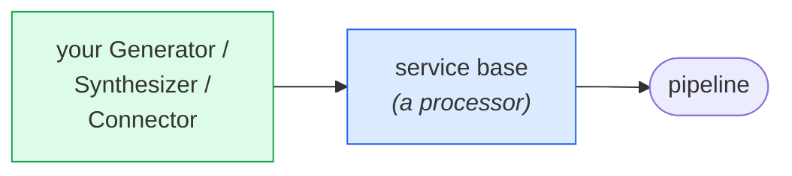

# Writing a service

Adding an STT, LLM or TTS provider means implementing a small interface, usually
one method, and letting the shared base handle the pipeline side: frames,
metrics, tracing, interruption, and the tool loop.

You do **not** write a processor for this. The base is the processor.

Give the service a type of its own that embeds the base, as every provider in
jargo does (`cartesia.TTSService`, `deepgram.STTService`), and pass it to the
base with `WithSelf`. The type is what your users hold and can type-switch on,
and `WithSelf` makes it the processor the pipeline runs, so a service switcher
or an observer comparing against it finds it. An LLM service needs no option:
it passes itself to `llm.New` as its `Generator`.

## The pattern



Follow the repository conventions: a plain `Config` struct validated with
`go-playground/validator` tags, no environment variables, no functional options.

## An LLM

Implement one method:

```go
type Generator interface {
    Generate(ctx context.Context, convo *frames.LLMContext, emit Emit) error
}
```

```go
package myllm

type Config struct {
    APIKey string `validate:"required"`
    Model  string
}

// LLMService is the MyProvider LLM service.
type LLMService struct {
    *llm.Base
    cfg Config
}

func NewLLM(cfg Config) *LLMService {
    if cfg.Model == "" {
        cfg.Model = "my-default-model"
    }
    s := &LLMService{cfg: cfg}
    s.Base = llm.New("MyLLM", s)
    s.SetModel(cfg.Model)     // reported as a span attribute
    return s
}

func (s *LLMService) Generate(ctx context.Context, convo *frames.LLMContext, emit llm.Emit) error {
    stream, err := s.startStream(ctx, convo.Messages())
    if err != nil {
        return err
    }
    defer stream.Close()

    for {
        select {
        case <-ctx.Done():
            return ctx.Err()      // interruption: stop immediately
        default:
        }

        delta, err := stream.Recv()
        if errors.Is(err, io.EOF) {
            return nil
        }
        if err != nil {
            return err
        }
        if err := emit(delta); err != nil {
            return err
        }
    }
}
```

`llm.Base` wraps that in `LLMFullResponseStartFrame` / `LLMTextFrame`s /
`LLMFullResponseEndFrame`, records TTFB and token usage, and opens the span.

**Honoring `ctx` is not optional.** Cancellation *is* the interruption mechanism:
ignore it and every barge-in stalls up to three seconds. Check it in the loop, and
pass it to your HTTP or WebSocket calls.

### Tool calling

Additionally implement `ToolGenerator`:

```go
type ToolGenerator interface {
    GenerateWithTools(ctx context.Context, convo *frames.LLMContext, sink Sink) error
}
```

Stream text to `sink.Text` and each requested call to `sink.Tool`. Return when the
model's turn completes. `llm.Base` runs the whole tool loop (dispatching handlers,
emitting the call frames, feeding results back) as long as the context carries
tools and your service implements this.

## A TTS service

```go
type Synthesizer interface {
    SampleRate() int
    RunTTS(ctx context.Context, text, contextID string, yield func(frames.Frame) error) error
}
```

```go
// TTSService is the MyProvider text-to-speech service.
type TTSService struct {
    *tts.Base
}

func NewTTS(cfg Config) *TTSService {
    s := &TTSService{}
    s.Base = tts.New("MyTTS", &synthesizer{cfg: cfg}, tts.WithSelf(s))
    return s
}

func (s *synthesizer) SampleRate() int { return s.cfg.SampleRate }

func (s *synthesizer) RunTTS(ctx context.Context, text, _ string, yield func(frames.Frame) error) error {
    resp, err := s.post(ctx, text)
    if err != nil {
        return err
    }
    defer resp.Body.Close()

    buf := make([]byte, 4096)
    for {
        n, err := resp.Body.Read(buf)
        if n > 0 {
            pcm := append([]byte(nil), buf[:n]...)
            if err := yield(frames.NewTTSAudioRawFrame(pcm, s.cfg.SampleRate, 1)); err != nil {
                return err // yield audio as it arrives
            }
        }
        if errors.Is(err, io.EOF) {
            return nil
        }
        if err != nil {
            return err
        }
    }
}
```

Yield audio **as it arrives**. Buffering the whole utterance before the first
frame adds its full synthesis time to perceived latency. It is the single most
common mistake in a TTS integration.

`tts.Base` handles chunking, the `TTSStartedFrame` / `TTSStoppedFrame` bracket,
`TTSAudioRawFrame`s, and TTFA measured from the first *audible* sample.

### Word timings

If your provider returns them, implement `WordTimestamps` as well. This is what
aligns `TTSTextFrame`s to the audio actually spoken, and therefore what lets an
interrupted response be recorded truncated instead of whole. Worth doing when the
API supports it.

If it also reports where each word ends, set `End` on each `WordTiming`. A
context's audio often arrives while the one before it is still playing, and its
words are then timed from where the earlier context's words end. Without word
ends, they are timed from where its last word starts, and run ahead of the
audio.

## An STT service

Streaming, for conversation:

```go
type Connector interface {
    Connect(ctx context.Context, sampleRate int) (Stream, error)
}

type Stream interface {
    Send(audio []byte) error
    Recv() ([]Result, error)
    Close() error
}
```

```go
// STTService is the MyProvider speech-to-text service.
type STTService struct {
    *stt.StreamService
}

func NewSTT(cfg Config) *STTService {
    s := &STTService{}
    s.StreamService = stt.NewStream("MySTT", &connector{cfg: cfg}, cfg.SampleRate, stt.WithSelf(s))
    return s
}
```

`stt.StreamService` turns that into a processor: `Send` gets the audio, and each
`Result` becomes an `InterimTranscriptionFrame` or a `TranscriptionFrame`
depending on its final flag. `service/wsutil` helps with WebSocket providers.

Mark interim results honestly. Reporting partials as final makes the bot answer
half-sentences.

For a provider with no streaming API, implement `Transcriber` and build it with
`stt.NewSegment(name, transcriber, sampleRate)` instead, accepting that there will
be no interim transcriptions.

## Metadata

Implement `Describer` on the connector or transcriber to announce useful facts
at pipeline start:

```go
func (c *connector) Metadata() stt.Metadata {
    return stt.Metadata{TTFSP99: new(300 * time.Millisecond)}
}
```

`STTMetadataFrame` carries this, and the turn-taking strategies use the p99
finalize latency to decide how long to wait for a transcript before giving up.
Supplying a real number measurably improves turn-taking; omitting it falls back to
a default.

## Checklist

- [ ] `Config` struct with `validate` tags; no env vars, no options.
- [ ] Defaults applied in the constructor for empty fields.
- [ ] `ctx` honored everywhere, including inside network calls.
- [ ] Output streamed incrementally, not buffered whole.
- [ ] `SetModel` called, so traces attribute correctly.
- [ ] Errors returned, not swallowed; the base converts them to `ErrorFrame`s.
- [ ] A test against a fake server; see the existing `provider/*/­*_test.go`.

## Contributing it

Providers live in `provider/<name>`. Commits follow Conventional Commits, and
`golangci-lint run` must be clean. See
[`AGENTS.md`](../../AGENTS.md) for the full conventions.

A provider that comes with a test against a recorded or faked response is much
easier to accept than one that needs live credentials to exercise.
