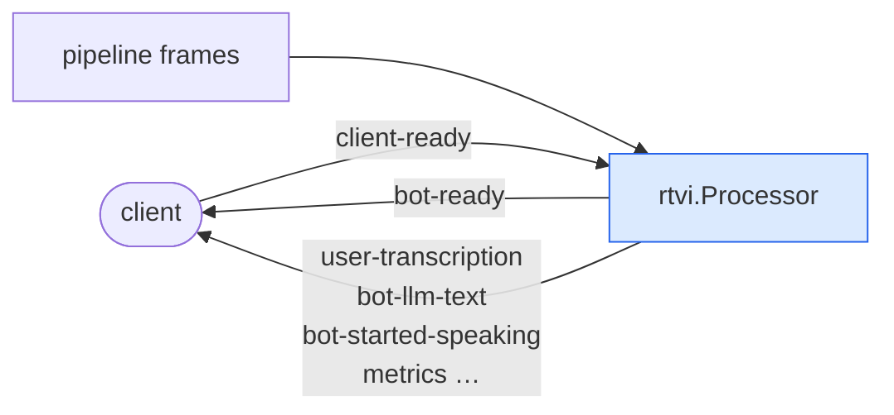

# RTVI

Audio is only half of what a client needs. A usable UI also wants transcriptions
as they arrive, who is speaking right now, and when the bot is thinking. RTVI
(Real-Time Voice Interface) is the JSON protocol that carries those events over the
WebRTC data channel.

Because it is an open protocol with existing web, iOS and Android client SDKs, a
jargo server works with clients you did not write.

## Adding it

One processor, placed **at the top of the pipeline**, ahead of the input
transport. What the client sends travels down the pipeline from there, by the
same path a real caller's input takes, and the messages it sends back reach the
output transport at the far end:

```go
pipeline.New(
    rtvi.NewProcessor(),   // <- here
    t.Input(), vadProc, stt, turnsProc,
    agg.User(), llm, tts,
    t.Output(), agg.Assistant(),
)
```

That is the whole integration. The processor watches frames going past and
translates the interesting ones into client messages.

## What it does



Incoming client messages arrive as `InputTransportMessageFrame`s; outgoing ones
are pushed downstream as `OutputTransportMessageUrgentFrame`s. **Urgent**, so a
transcription reaches the UI ahead of queued audio instead of lagging behind the
speech it describes.

## The messages

Every message is `{"label":"rtvi-ai","type":…,"id":…,"data":…}`. The processor
speaks protocol version `2.4.0`.

The `client-ready` handshake settles which version the session speaks. A client
of this generation is answered with `2.4.0`; one of the previous generation
(`1.x`) is answered with its own version, so it stays on the paths it
understands. Any other version gets an `error-response` saying so, and the
session goes ahead anyway: the client is better placed than the bot to decide
whether to carry on. `Processor.ClientVersion` reports what the client declared.

Some messages are sent only to clients of a version that knows them. Until the
`client-ready` arrives the bot does not know the client's version, so it sends
messages as it would to a client of its own version: a bot may speak before
then, as when it greets on connect. `Processor.ClientReady` reports whether the
handshake has happened.

The `bot-ready` also carries `capabilities`: what the bot does in the session
(`audio_in`, `audio_out`, `video_in`, `screen_in`, `video_out` and `metrics`), so a
client can show only the UI that applies. The worker derives it from its
transports and from `Params.EnableMetrics`; set `WorkerConfig.Capabilities` for
what the pipeline cannot show. A field nobody knows is left out, and the client
keeps its default for it.

In an [expressive conversation](expressive-conversation.md) (alpha), each
`bot-output` for text the bot has spoken carries `delivery`, the delivery the
words were spoken in (such as `["cheerful", "emphasis"]`, empty for the voice's
baseline), and each sound or pause the TTS performed is a `bot-output` segment
of its own, of type `expression_sound` (its text is the sound's name) or
`expression_pause` (its text is the milliseconds). Sounds and pauses came with
protocol 2.3.0, so an earlier client, which would take one for part of the
bot's response, is not sent them.

| Type | Meaning |
|---|---|
| `client-ready` → `bot-ready` | The handshake. |
| `user-transcription` | What the user said (interim and final). Deprecated: read `user-input` or `stt-raw-text`. |
| `user-input` | What the user said or typed: transcriptions (interim and final), backchannels, and the text sent with `send-text`, acknowledged with its id and, when the transport knows, its sender. In an [expressive conversation](expressive-conversation.md#perception) (alpha), a transcription with a reading of how the user spoke carries it in `perception`. |
| `bot-transcription` | What the bot's LLM said, a sentence at a time. Deprecated: read `bot-output`, which carries the same sentences along with whether and how far the bot has spoken them. |
| `bot-llm-text` / `bot-tts-text` | Streamed response text, per stage. Deprecated: read `llm-raw-text` and `tts-raw-text`. |
| `stt-raw-text` / `llm-raw-text` / `tts-raw-text` | The text each service produced, as it produced it. Off by default, and only sent to clients of protocol 2.2.0 or later. |
| `bot-output` | What the bot says, a segment at a time, with whether and how far it has spoken it. |
| `user-started-speaking` / `user-stopped-speaking` | Turn boundaries. |
| `vad-user-started-speaking` / `vad-user-stopped-speaking` | The raw VAD signal, off by default. |
| `bot-started-speaking` / `bot-stopped-speaking` | Bot speech boundaries. |
| `bot-interrupted` | The bot was cut off; drop what it was mid-saying. |
| `bot-llm-started` / `bot-llm-stopped` | Model is generating. |
| `bot-tts-started` / `bot-tts-stopped` | Speech is being synthesized. |
| `llm-function-call-started` / `-in-progress` / `-stopped` | Tool activity, stage by stage. |
| `user-audio-level` / `bot-audio-level` | How loud each side is, for a speaking meter. Off by default. |
| `dtmf` | Client presses keypad keys. |
| `metrics` | TTFB, processing time, token usage. |
| `send-text` | Client sends text instead of speech. |
| `raw-audio` / `raw-audio-batch` | Client sends audio it captured itself: 16-bit PCM, base64-encoded, with its `sampleRate` and `numChannels`. A malformed one gets an `error-response`, and a batch with a bad chunk pushes none of its audio. |
| `disconnect-bot` | Client hangs up; the pipeline ends gracefully. |
| `llm-function-call-result` | Result of a tool the client ran for the bot. |
| `client-message` → `server-response` | Anything else the client asks, and the answer. |
| `server-message` | Anything else the bot tells the client, unprompted. |
| `flow-node-entered` | The bot's conversation flow (the `flows` package) entered a node: the `node`, the `previous_node` it left, the `function` whose call moved it there, their `metadata` and `function_metadata` and, for a node of a subflow, the `parent` node that runs the subflow. A field with no value is left out. Sent to clients of protocol 2.4.0 or later. In the pipeline it is a `rtvi.FlowNodeEnteredFrame`. |
| `error-response` | A request could not be carried out. |
| `error` | Something failed. |

The constants live in `processor/rtvi` (`rtvi.TypeUserTranscription` and so on),
so you do not hand-write the strings.

With an STT service's diarization on, the `user-input` and `stt-raw-text`
messages of a transcription carry who said it in `speaker`: the provider's
label and the speaker's number, 1 for whoever spoke first, such as
`"speaker": {"label": "B", "number": 2}`. It is left out when diarization is
off. `user_id` is the transport's participant, not the speaker. The deprecated
`user-transcription` does not carry it.

### What the server accepts

A client message the server cannot carry out, of an unknown type or with data
that does not match its payload (a required field missing, or a field of the
wrong type), gets an `error-response` carrying its id. A message labeled
`rtvi-ai` that is not an RTVI message at all, such as one without an id, gets an
`error`, since there is no id to answer. A message without the label is
ignored.

A receiver ignores the fields and message types it does not know, so a later
protocol version can add them: the server ignores an unknown field in a client
message's data, and the client side (`transport/wsclient/rtviclient`) skips a
server message it has no mapping for.

### Messages of your own

`client-message` carries whatever the protocol has no message for. It arrives as
a `rtvi.ClientMessageFrame` travelling downstream, so a processor anywhere in the
pipeline can answer it by pushing a `rtvi.ServerResponseFrame` naming the request:

```go
if msg, ok := f.(*rtvi.ClientMessageFrame); ok && msg.Type == "set-theme" {
    return p.PushFrame(ctx, rtvi.NewServerResponseFrame(msg, map[string]any{"ok": true}), processor.Upstream)
}
```

`rtvi.NewServerErrorResponseFrame(msg, reason)` refuses it instead, and the client
gets an `error-response`. Either way the request is answered, so a client waiting
on a reply is never left waiting.

Outside the pipeline, attach to the processor's `rtvi.EventClientMessage` and
answer with `SendServerResponse` or `SendErrorResponse`. To tell the client
something nothing asked for, push a `rtvi.ServerMessageFrame` or call
`SendServerMessage`.

### How much a tool call reports

A tool call's name and its arguments can carry information a client has no
business seeing, so the observer reports the tool call id alone by default. Raise
it per function, with `"*"` setting the default for the rest:

```go
params := rtvi.ObserverParams{
    FunctionCallReportLevel: map[string]rtvi.FunctionCallReportLevel{
        "*":           rtvi.ReportNone, // id only
        "get_weather": rtvi.ReportFull, // name, arguments and result
    },
}
observer := rtvi.NewObserverWithParams(proc, params)
```

The levels are `disabled` (no event at all), `none`, `name`, `arguments`
(the name and the arguments, but no result) and `full`. The raw
VAD speaking events are off by default in the same way, under
`VADUserSpeakingEnabled`.

So are the audio levels a client draws a speaking meter from, under
`UserAudioLevelEnabled` and `BotAudioLevelEnabled`. They are a message every
`AudioLevelPeriod` (150 ms by default) for as long as the call lasts, which a
client that draws no meter does not want. The level is loudness on a 0..1 scale,
measured over a rolling 400 ms window rather than per frame, so it reads 0 until
enough audio has arrived to measure.

## Clients

For the browser, use the client packages in
[jargo-client-react](https://github.com/gojargo/jargo-client-react).

The examples on the dev runner (`examples/getting-started`, `examples/voice` and
the others built on the `runner` package) serve a prebuilt browser client at
<http://localhost:7860>, so they need nothing extra. `examples/echo` and
`examples/voicebot` serve their own minimal page.

## Without RTVI

The processor is optional. Leave it out and you still have working audio. You
just have no event stream, so the UI cannot show live transcriptions or speaking
state. Phone transports have no data channel at all, which is why
[`examples/twiliobot`](../../examples/twiliobot) omits it.

To send your own application messages instead, push an
`OutputTransportMessageFrame` (ordered with the audio) or an
`OutputTransportMessageUrgentFrame` (ahead of it), and read
`InputTransportMessageFrame` for what the client sends back.
